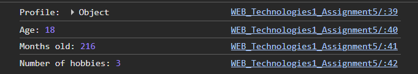
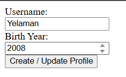
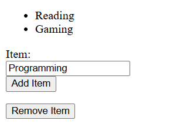
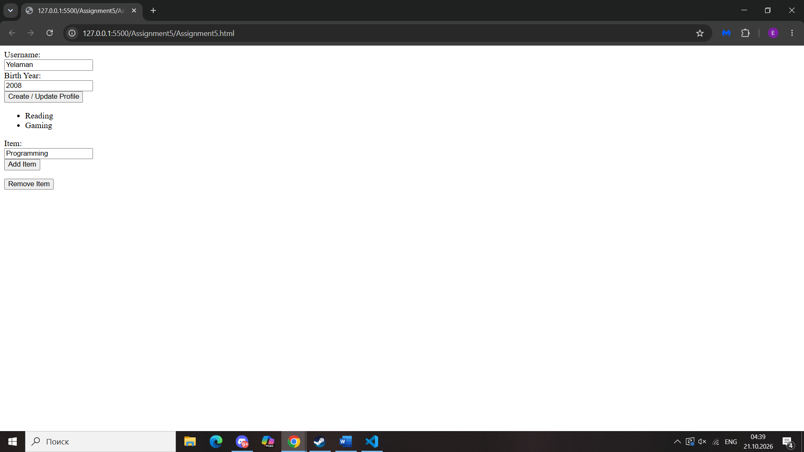

# WEB_Technologies1_Assignment5

**Name:** Assanbayev Yelaman  
**Group:** SE-2538

## Part 1. Profile Object, Data Types & Arithmetic

### Task 1. The Personal Info Object

Created a const object `userProfile` with a string (`name`), number (`birthYear`), boolean (`isDeveloper`), and array (`hobbies`).

### Task 2. Arithmetic Calculations

Calculated age dynamically (`currentYear - birthYear`), months old (`age * 12`), and hobbies count (`.length`).

## Part 2. Form Input & Event Responses

### Task 3. HTML Form Setup

Created a form with Username, Birth Year, and "Create / Update Profile" submit button.

### Task 4. Event Listener

Added a `submit` event listener to the form. On submit, it captures the user's input values and updates the `userProfile` object.

## Part 3. DOM List Manipulation

### Task 5. Creating & Removing Elements

`<ul>` of hobbies. Add Item creates an `<li>` from an input. Remove Item deletes the last `<li>`

## Summary

Built an object, made arithmetic calculations, added forms and inputs, added an event listener to the button, created `<ul>` with add/remove handlers.

